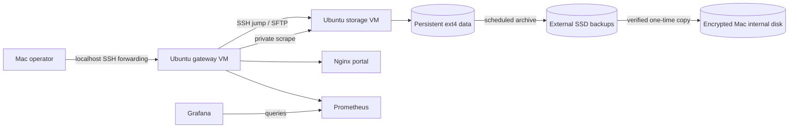
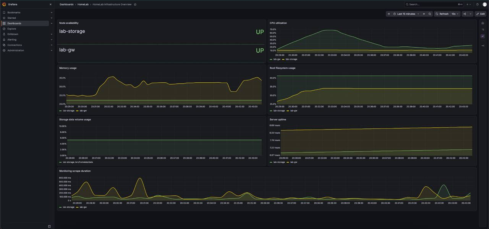

# HomeLab Infrastructure
**A reproducible, two-node Linux infrastructure lab built, operated, and recovered on an 8 GB Intel MacBook Pro.**

VirtualBox · Ubuntu Server · Ansible · Docker Compose · Nginx · SFTP · Prometheus · Grafana · SSH · UFW · Backup & recovery

This project began as a working private infrastructure environment and progressed into a **fresh-deployment and recovery exercise**. I built two isolated Ubuntu VMs, automated their configuration, deliberately interrupted services to test detection and repair, and validated storage and monitoring restores. I subsequently reproduced the services on a separate pair of fresh VirtualBox guests.

> **Scope:** A local engineering lab, not a public hosting platform or a high-availability system. All verification claims below are limited to the recorded tests.

Built and tested by **Itzjac Lechtman**.

## At a glance

| Area | Design and demonstrated result |
| --- | --- |
| **Two-node topology** | A gateway VM serves Nginx, Prometheus and Grafana; an isolated storage VM provides SFTP and host metrics. |
| **Restricted access** | The Mac reaches the gateway through localhost-bound SSH forwarding and reaches storage through an SSH jump. Storage has no default IPv4/IPv6 route in the final acceptance checks. |
| **Infrastructure as code** | Ansible manages security, storage and Docker services. A separate VirtualBox/cloud-init/Ansible workflow bootstrapped two *new* Ubuntu guests; a second run reported zero changes. |
| **Observability** | Three Prometheus scrape jobs were healthy. A controlled exporter outage triggered the **NodeDown** alert, which cleared after service restoration. |
| **Recovery** | Operator-initiated Ansible repair restored the Nginx portal without recreating its container. Isolated restores recovered historical Prometheus series and the archived Grafana dashboard via API. |
| **Backups** | A scheduled 20:00 storage backup completed with checksum verification. A separate copy on the Mac's FileVault-encrypted internal disk was verified and test-extracted. |

## Architecture



The gateway runs the web interfaces on loopback, accessed through SSH tunnels. The storage guest has its own private VirtualBox network and ext4 filesystem. See [architecture and trust boundaries](docs/ARCHITECTURE.md) and [security design](docs/SECURITY.md) for precise configuration.

## Demonstrated evidence

[](docs/EVIDENCE_GALLERY.md)

| Deployed services | Failure detection | Isolation |
| --- | --- | --- |
| [Nginx portal](docs/assets/evidence/portal-operational.png) | [NodeDown firing](docs/assets/evidence/node-down-firing.png) | [Storage isolation checks](docs/tests/TEST-004-engineering-completion.md#fresh-deployment-on-the-mac) |
| [Prometheus targets UP](docs/assets/evidence/prometheus-three-targets-up.png) | [NodeDown cleared](docs/assets/evidence/node-down-cleared.png) | [Storage filesystem metrics](docs/assets/evidence/storage-available-metric.png) |

Browse the [eight genuine screenshots](docs/EVIDENCE_GALLERY.md). Point-in-time screenshots support the depicted UI and alert states; **fresh provisioning, archival restoration and backup integrity** are documented separately in the [engineering completion test](docs/tests/TEST-004-engineering-completion.md).

## How to inspect or reproduce it

This repository contains two complementary workflows:

1. **Fresh provisioning:** [VirtualBox + Ubuntu Cloud + cloud-init + Ansible](docs/FRESH_DEPLOYMENT.md) creates and configures a separate pair of guests. The recorded acceptance included removing the test storage VM's temporary NAT adapter, rebooting it, verifying its persistent mount and SFTP round trip, and passing nine live checks.
2. **Existing-lab operations:** [Build guide](docs/BUILD_GUIDE.md) and [runbook](docs/RUNBOOK.md) describe the reference pair's configuration and guarded management playbooks.

On a configured controller, with dependencies installed:

```bash
make validate       # offline tests, syntax checks and Compose validation
make validate-live  # read-only SSH, routing, mount and service checks
```

Recovery testing is deliberately **separate and opt-in**; consult the [recovery runbook](docs/RUNBOOK.md) before running `make test-recovery`. Do not target existing VMs without explicit approval.

## Engineering decisions and tradeoffs

- **Low-resource host:** The reference system shares an 8 GB Mac, making memory, storage and service restart behavior important design constraints.
- **Minimized exposure:** SSH keys, a jump-host boundary, restrictive firewall rules and localhost-only browser access were preferred over publicly exposed ports.
- **Evidence-driven recovery:** Tests compared data integrity, service readiness, historical metrics and archived dashboard API responses rather than assuming a backup archive was usable.
- **Safe test isolation:** Disposable recovery containers had no network access or published ports and used scratch-only data mounts with cleanup checks.

### Explicit limitations

Recurring copies to independent physical media have been **implemented but not scheduled**; only a one-time off-device copy was exercised. A complete physical-device-loss restore, original Grafana-account authentication from restored data, and measured RTO/RPO remain unverified. Recovery is **operator-initiated**, not automatic failover or self-healing.

## Project documentation

| Read | Purpose |
| --- | --- |
| [Engineering case study](docs/PORTFOLIO_CASE_STUDY.md) | Problem, implementation choices, validation and outcomes |
| [Fresh deployment](docs/FRESH_DEPLOYMENT.md) | Provision and bootstrap two new VMs |
| [Architecture](docs/ARCHITECTURE.md) | Host, network, services and data flow |
| [Test matrix](docs/TEST_PLAN.md) and [TEST-004](docs/tests/TEST-004-engineering-completion.md) | Actual acceptance evidence and boundaries |
| [Recovery runbook](docs/RUNBOOK.md) and [backup runbook](docs/PHASE05-BACKUP-RUNBOOK.md) | Safe operation and restore procedures |
| [Demo production guide](docs/DEMO_PRODUCTION_GUIDE.md) | 105-second walkthrough script, shot list and recording checklist |
| [Project status](docs/PROJECT_STATUS.md) | What passed and what remains |
| [Publication review](docs/PUBLICATION_REVIEW.md) | Pre-public release checks and caveats |

**Project type:** independently built and tested learning/portfolio lab. All failure and restore claims refer to controlled, documented local tests.
