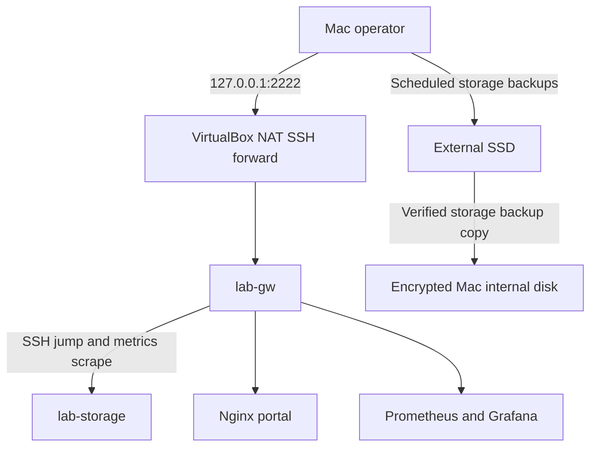

# Architecture

The verified deployment used two Ubuntu Server 26.04.1 LTS VMs in VirtualBox on an Intel MacBook Pro. The VMs and backup copies reside on an external APFS SSD. The gateway has VirtualBox NAT for outbound access and an internal interface. Storage uses the same internal network and had no IPv4 default route in the Phase 06 audit.

| Connection or storage path | Deployed configuration |
| --- | --- |
| Mac to gateway SSH | `homelab` resolves to `127.0.0.1:2222` on the Mac. VirtualBox forwards to guest TCP 22. |
| Gateway NAT interface | DHCP on `enp0s3`; recorded address `10.0.2.15/24` and default route through `10.0.2.2`. |
| Gateway to storage | VirtualBox internal network `homelab-private`, gateway `10.20.0.10/24`, storage `10.20.0.20/24`, both on `enp0s8`. |
| Storage SSH/SFTP and metrics | TCP 22 and 9100 on storage, allowed from `10.20.0.10` by UFW. Mac SSH uses the `homelab-storage` jump alias. |
| Browser services | Gateway loopback TCP 8080 for Nginx, 9090 for Prometheus, 3000 for Grafana. Mac access via SSH forwarding. |
| Metrics | Prometheus scrapes itself and gateway Node Exporter on the Compose network, and storage Node Exporter over the private link. Grafana queries Prometheus over the Compose network. |
| Persistent data | Storage files are on ext4 LVM at `/srv/homelab/data/files`. Monitoring uses named Docker volumes on the gateway. |

The monitoring project always uses the base Compose file and both overlays. Prometheus retains up to seven days or 512 MB of TSDB data. Published gateway web ports bind to loopback. The gateway exporter uses the host PID namespace and a read-only root filesystem bind mount for metrics.

The [fresh deployment workflow](FRESH_DEPLOYMENT.md) uses a separate VirtualBox internal network, SSH port and per-run host keys. The topology above shows the original lab and its storage backup path.

See the [security model](SECURITY.md) and [operations runbook](RUNBOOK.md) for safeguards and recovery scope.
