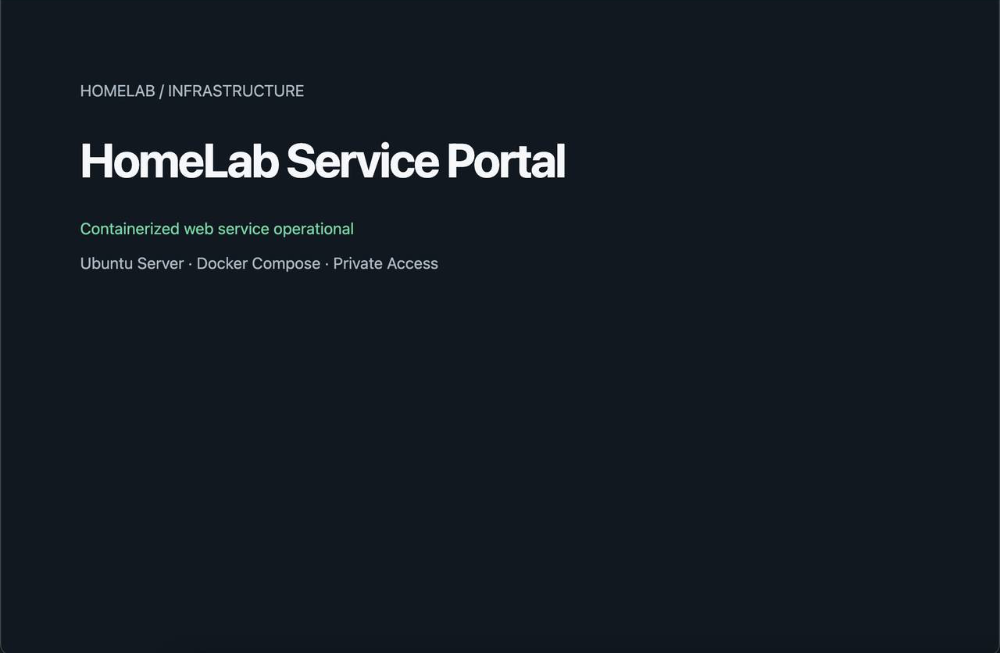
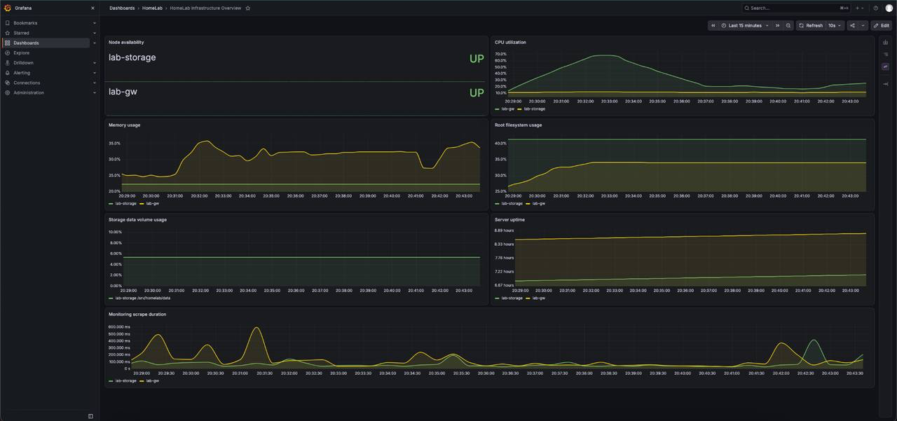
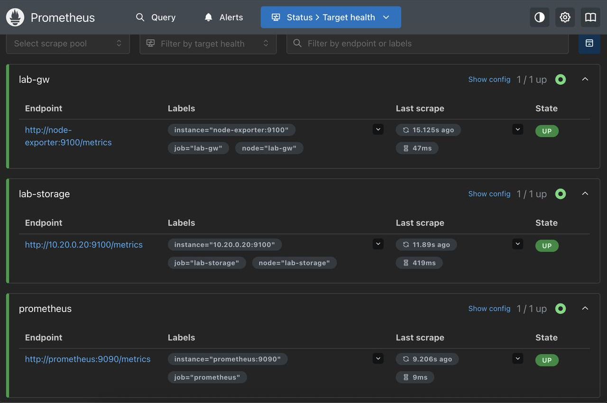
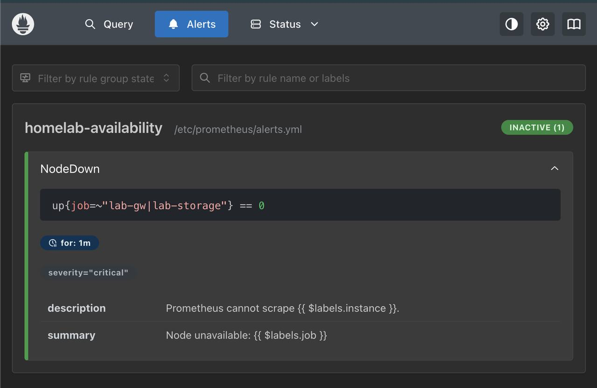
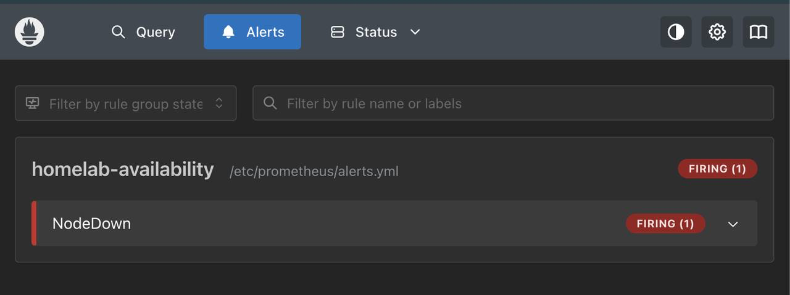
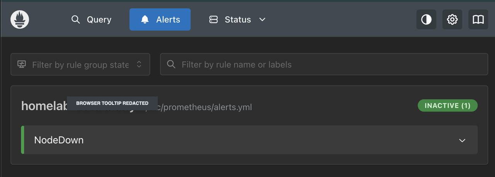
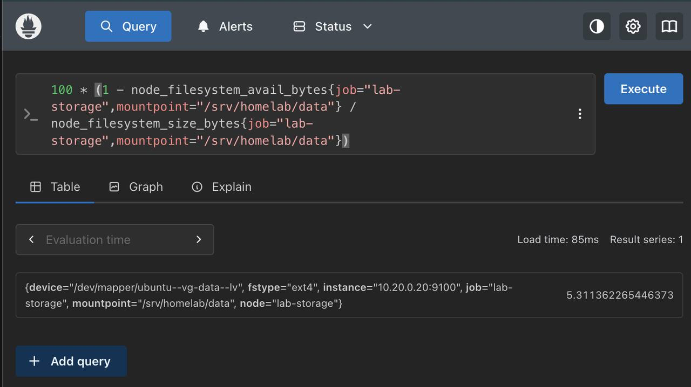

# Visual evidence — real HomeLab test captures

These eight genuine screenshots record point-in-time states from the November 23–24, 2026 HomeLab build. Source archives and unredacted terminal evidence are private.

## 1. Deployed services

### Nginx service portal

The gateway served the HomeLab Service Portal over local access. The controlled container stop/recovery drill is separately documented in [INC-002](incidents/INC-002-portal-recovery.md).

### Grafana dashboard

Dashboard panels display node and resource metrics. This is the deployed dashboard, **not** a restored-dashboard acceptance test.

### Prometheus targets

All three scrape targets were UP in the captured view.

## 2. Alerting — a controlled failure drill

### Alert definition / inactive baseline

NodeDown was configured for the gateway and storage exporters and initially INACTIVE.

### Exporter outage detected

The rule transitioned to FIRING during the controlled exporter interruption.

### Alert cleared after recovery

The same rule returned to INACTIVE after service recovery. The labeled redaction covers an unrelated browser tooltip over part of the group heading. The NodeDown row and INACTIVE badge are intact. See [INC-001](incidents/INC-001-node-exporter-outage.md).

## 3. Storage metrics

### Storage available

### Storage free

Final-state jump-host access and the absence of default IPv4 and IPv6 routes are documented in [TEST-004](tests/TEST-004-engineering-completion.md#fresh-deployment-on-the-mac).

## 4. Limits on what images establish

- Recovery test success for Prometheus WAL replay, Grafana SQLite health, archive checksums, backup scheduling and Ansible idempotency is documented in [TEST-002](tests/TEST-002-monitoring-data-restore.md), [TEST-003](tests/TEST-003-monitoring-application-recovery.md), and the [evidence index](../evidence/README.md). These outcomes were documented primarily in terminal logs, **not** falsely represented by UI screenshots.
- No screenshot in this gallery demonstrates a complete fresh-VM rebuild, an off-device disaster restore, Grafana login/dashboard revalidation after restore, or historical PromQL against a restored Prometheus TSDB.
- Browser chrome was cropped from the portal, Grafana, and Prometheus targets captures. Outside the labeled tooltip redaction in the alert-cleared capture, retained pixels were preserved during PNG export.
